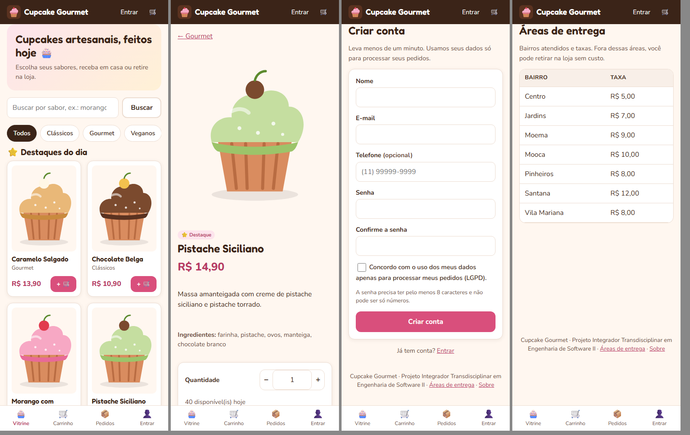

# 🧁 Cupcake Gourmet

Vitrine virtual, pedidos, pagamento e acompanhamento de entrega para uma loja de cupcakes gourmet.
Projeto Integrador Transdisciplinar em Engenharia de Software **II** (Cruzeiro do Sul Virtual), construído a partir da especificação ágil do PIT I.


| | |
|---|---|
| **App em produção** | https://cupcake-gourmet-2uvn.onrender.com (o 1º acesso pode levar ~50 s para "acordar") |
| **Vídeo de apresentação** | _link_ |
| **Stack** | Python 3.14 · Django 6 (MVC) · PostgreSQL · HTML/CSS/JS · pytest |
| **Hospedagem** | Render (web) + Neon (PostgreSQL) |
| **Qualidade** | 84 testes automatizados · 94% de cobertura · CI no GitHub Actions |



## Funcionalidades

**Cliente:** vitrine por categoria, busca, detalhe do cupcake, carrinho, cadastro e login, endereços, checkout com entrega (taxa por bairro) ou retirada, pagamento Pix/cartão simulado ou na entrega, linha do tempo do pedido, cancelamento e PWA instalável.

**Administrador:** painel com vendas do dia e alerta de estoque, fila de pedidos com avanço de status, cadastro de cupcakes, categorias e zonas de entrega.

## Documentação (por situação-problema)

| Situação | Conteúdo |
|---|---|
| **1 – Planejamento revisado** | [Escopo e revisão do PIT I](docs/situacao-1/01-escopo-e-revisao.md) · [Requisitos (US, Gherkin, RN, RNF, rastreabilidade)](docs/situacao-1/02-requisitos.md) · [UML](docs/situacao-1/03-uml.md) · [IHC e mensagens](docs/situacao-1/04-ihc.md) · [Banco de dados e dicionário](docs/situacao-1/05-banco-de-dados.md) · [DDL PostgreSQL](docs/situacao-1/ddl-postgres.sql) |
| **2 – Desenvolvimento** | [Arquitetura MVC e padrões](docs/situacao-2/01-arquitetura.md) · [Manual de uso](docs/situacao-2/02-manual-de-uso.md) · [Deploy](docs/situacao-2/03-deploy.md) · [Roteiro do vídeo](docs/situacao-2/04-roteiro-video.md) |
| **3 – Testes e validação** | [Plano e relatório de testes](docs/situacao-3/01-plano-e-relatorio-de-testes.md) · [Template de laudo](docs/situacao-3/02-template-laudo-testador.md) · [Laudo de qualidade](docs/situacao-3/03-laudo-de-qualidade.md) · [Laudos dos testadores](docs/situacao-3/laudos/) |

## Rodando localmente

```bash
python -m venv .venv
.venv\Scripts\activate          # Windows  (Linux/macOS: source .venv/bin/activate)
pip install -r requirements-dev.txt
python manage.py migrate
python manage.py seed           # cupcakes, zonas, admin@cupcake.dev / Admin@12345, cliente@cupcake.dev / Cliente@123
python manage.py runserver
```

Acesse http://127.0.0.1:8000. Sem `DATABASE_URL`, o projeto usa SQLite.

## Testes

```bash
coverage run -m pytest            # 84 testes: unitários, integração e aceitação
pytest -m aceitacao               # só os cenários Gherkin das histórias
coverage report
python scripts/smoke_prod.py https://cupcake-gourmet-2uvn.onrender.com   # teste de sistema E2E em produção
```

## Arquitetura (resumo)

```
Navegador ─HTTP─▶ urls.py ─▶ views.py (Controller) ─▶ services.py (regras) ─▶ models.py (ORM) ─▶ PostgreSQL
                                   │                        └─▶ GatewayPagamento (Strategy)
                                   └─▶ templates/ (View) ─HTML─▶ Navegador
```

Detalhes em [docs/situacao-2/01-arquitetura.md](docs/situacao-2/01-arquitetura.md).

## Autor

João Pedro Andrade Modesti · Engenharia de Software · Cruzeiro do Sul Virtual · 2026
