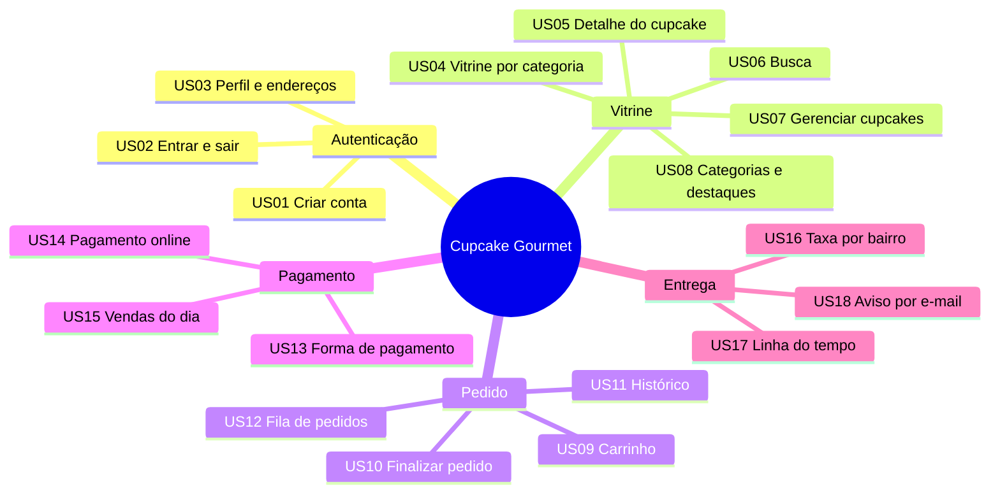

# Situação 1 · Requisitos

## 1. Mapa de afinidade (temas do PIT I)



## 2. Backlog priorizado (MoSCoW)

Legenda de status: ✅ implementado e testado · ⏭️ adiado para a v2.

| ID | História | Persona | Prioridade | Pts | Status |
|---|---|---|---|---|---|
| US01 | Como **visitante**, quero **criar uma conta** para fazer pedidos | Cliente | Must | 3 | ✅ |
| US02 | Como **usuário**, quero **entrar e sair** com e-mail e senha para acessar minha área | Cliente/Admin | Must | 2 | ✅ |
| US03 | Como **cliente**, quero **gerenciar meu perfil e endereços** para agilizar a entrega | Cliente | Should | 3 | ✅ |
| US04 | Como **cliente**, quero **ver a vitrine por categoria** para escolher sabores | Cliente | Must | 3 | ✅ |
| US05 | Como **cliente**, quero **ver detalhes do cupcake** (foto, descrição, ingredientes e preço) para decidir a compra | Cliente | Must | 2 | ✅ |
| US06 | Como **cliente**, quero **buscar por nome ou sabor** para achar rápido o que quero | Cliente | Should | 2 | ✅ |
| US07 | Como **admin**, quero **cadastrar, editar e desativar cupcakes** (preço, estoque, destaque) para manter a vitrine atualizada | Admin | Must | 5 | ✅ |
| US08 | Como **admin**, quero **gerenciar categorias e destaques** para organizar a vitrine | Admin | Should | 3 | ✅ |
| US09 | Como **cliente**, quero **adicionar itens ao carrinho e alterar quantidades** para montar meu pedido | Cliente | Must | 3 | ✅ |
| US10 | Como **cliente**, quero **finalizar o pedido escolhendo entrega ou retirada** para receber meus cupcakes | Cliente | Must | 5 | ✅ |
| US11 | Como **cliente**, quero **ver o histórico dos meus pedidos** (e cancelar se ainda não começou o preparo) | Cliente | Must | 2 | ✅ |
| US12 | Como **admin**, quero **ver a fila de pedidos e avançar o status** para organizar a produção | Admin | Must | 5 | ✅ |
| US13 | Como **cliente**, quero **escolher Pix, cartão ou pagamento na entrega** | Cliente | Should | 2 | ✅ |
| US14 | Como **cliente**, quero **pagar online e receber a confirmação** (simulado) | Cliente | Should | 3 | ✅ |
| US15 | Como **admin**, quero **ver o total vendido no dia** (pedidos, faturamento, ticket médio) | Admin | Could | 3 | ✅ |
| US16 | Como **cliente**, quero **ver a taxa de entrega do meu bairro antes de fechar** o pedido | Cliente | Should | 2 | ✅ |
| US17 | Como **cliente**, quero **acompanhar a linha do tempo de status** do pedido | Cliente | Should | 3 | ✅ |
| US18 | Como **cliente**, quero **receber um e-mail quando o pedido sair para entrega** | Cliente | Won't (v2) | 5 | ⏭️ |

**Total: 17 de 18 histórias entregues (52 de 57 pontos).**

## 3. Critérios de aceitação (Gherkin)

Os cenários abaixo viraram testes automatizados em `tests/test_aceitacao.py`.

```gherkin
Funcionalidade: Conta do cliente (US01, US02)
  Cenário: Visitante cria conta e entra
    Dado que sou um visitante sem conta
    Quando preencho nome, e-mail, senha válida, confirmação e aceito a política de dados
    Então minha conta é criada, fico logado e vejo "Bem-vindo(a)"
  Cenário: E-mail já cadastrado
    Dado que já existe conta com "ana@teste.com"
    Quando tento me cadastrar com esse e-mail
    Então vejo "Já existe uma conta com este e-mail. Tente entrar."

Funcionalidade: Vitrine e carrinho (US04, US05, US06, US09)
  Cenário: Montar carrinho a partir da vitrine
    Dado que estou na vitrine
    Quando filtro por categoria, abro um cupcake e adiciono 2 unidades
    Então o carrinho mostra o item e o subtotal correto
  Cenário: Quantidade acima do estoque
    Dado que restam 10 unidades de "Morango"
    Quando tento adicionar 11
    Então vejo "Só temos 10 unidade(s) de Morango hoje." e o carrinho não muda

Funcionalidade: Pedido com entrega, pagamento e acompanhamento (US10, US13, US14, US16, US17)
  Cenário: Compra com entrega paga via Pix
    Dado que sou cliente com endereço no bairro "Centro" (taxa R$ 5,00) e tenho 2 cupcakes de R$ 10,00 no carrinho
    Quando escolho entrega e Pix e confirmo
    Então o total é R$ 25,00 e vejo o código Pix
    E quando confirmo o pagamento e a loja avança o pedido até a entrega
    Então vejo a linha do tempo Recebido → Em preparo → Saiu para entrega → Entregue
  Cenário: Bairro não atendido
    Dado que meu endereço fica num bairro sem zona de entrega
    Quando abro o checkout
    Então o endereço aparece desabilitado com "Ainda não entregamos neste bairro"

Funcionalidade: Cancelamento (US11, RN04)
  Cenário: Cancelar pedido ainda não preparado
    Dado que meu pedido está "Recebido"
    Quando clico em cancelar e confirmo
    Então o pedido fica "Cancelado" e o estoque é devolvido
  Cenário: Pedido em preparo
    Dado que meu pedido está "Em preparo"
    Então não vejo mais a opção de cancelar

Funcionalidade: Gestão da loja (US07, US12, US15)
  Cenário: Admin cadastra cupcake e acompanha a venda
    Dado que sou administrador
    Quando cadastro "Doce de Leite" e um cliente compra 3 unidades com entrega no Centro
    Então o cupcake aparece na vitrine e o painel mostra 1 pedido e R$ 41,00 vendidos
  Cenário: Pagamento pendente bloqueia o preparo (RN08)
    Dado um pedido pago com Pix ainda não confirmado
    Quando tento avançar para "Em preparo"
    Então vejo "Aguardando confirmação do pagamento para iniciar o preparo."
```

## 4. Regras de negócio

| ID | Regra | Onde é garantida |
|---|---|---|
| RN01 | Produto inativo, sem estoque ou de categoria inativa não aparece na vitrine e não entra no carrinho | `ProdutoQuerySet.disponiveis`, `Carrinho.adicionar` |
| RN02 | O preço unitário é **congelado** no item do pedido. Alterar o preço depois não afeta pedidos antigos. | `ItemPedido.preco_unitario`, `services.criar_pedido` |
| RN03 | Ciclo de status: `RECEBIDO → EM_PREPARO → SAIU_PARA_ENTREGA` (ou `PRONTO_RETIRADA`) `→ ENTREGUE`. Só o admin avança. | `services.proximo_status` / `avancar_status` |
| RN04 | O cliente só cancela pedidos em `RECEBIDO`. O admin cancela qualquer pedido não finalizado. Cancelar devolve o estoque e estorna o pagamento aprovado. | `services.cancelar_pedido` |
| RN05 | A taxa de entrega depende do bairro (zona ativa). A retirada não tem taxa. Bairro não atendido bloqueia a entrega. | `services.calcular_taxa` + CHECK `ck_pedido_retirada_sem_taxa` |
| RN06 | Os totais são **sempre calculados no servidor** a partir do banco. O carrinho guarda só ids e quantidades. | `Carrinho`, `criar_pedido` |
| RN07 | O cliente só acessa os próprios pedidos e endereços (404 para os demais). O `/painel` exige perfil ADMIN (403). | `_pedido_do_usuario`, `admin_requerido` |
| RN08 | Pedido com pagamento online só vai para preparo após aprovação. Pagamento na entrega é liberado e marcado como pago ao entregar. | `Pagamento.liberado_para_preparo`, `avancar_status` |

## 5. Requisitos não funcionais

| ID | Categoria | Requisito | Como foi atendido |
|---|---|---|---|
| RNF01 | Usabilidade/portabilidade | Interface responsiva **mobile-first** (vem do PIT I) | CSS mobile-first, barra de navegação inferior no celular, PWA instalável |
| RNF02 | Segurança | Senhas com hash, proteção CSRF, sessão segura e HTTPS | PBKDF2 do Django, `CsrfViewMiddleware`, `SECURE_*` em produção, logout só via POST, proteção contra open redirect |
| RNF03 | Desempenho | Vitrine carrega em menos de 2 s em 4G | Páginas server-side sem framework JS, SVGs leves, estáticos comprimidos e com cache (WhiteNoise) |
| RNF04 | Usabilidade | Feedback em toda ação, confirmação de ações destrutivas e mensagens claras | Django messages, `data-confirmar`, páginas 403/404/500 amigáveis |
| RNF05 | Manutenibilidade | Arquitetura MVC com regras isoladas em services | Ver [situacao-2/01-arquitetura.md](../situacao-2/01-arquitetura.md) |
| RNF06 | Testabilidade | Pelo menos 70% de cobertura nas regras de negócio | **94%** de cobertura total e 98% em `services.py` |
| RNF07 | Privacidade (LGPD) | Coleta mínima, consentimento explícito e nenhum dado de cartão | Aceite obrigatório no cadastro e pagamento simulado sem dados de cartão |
| RNF08 | Integridade | Restrições garantidas no SGBD | FKs, UNIQUE e CHECKs (ver dicionário de dados) |

## 6. Matriz de rastreabilidade (história → código → teste)

| História | Controller (view) | Regra / service | Testes |
|---|---|---|---|
| US01, US02 | `contas.views.cadastrar`, `EntrarView` | `CadastroForm` | `test_cadastro_*`, `test_login_*`, `test_us01_us02_*` |
| US03 | `contas.views.perfil`, `endereco_form` | `_salvar_endereco` | `test_endereco_principal_unico`, `test_nao_edita_endereco_de_outro` |
| US04–US06 | `catalogo.views.vitrine`, `detalhe` | RN01 | `test_vitrine_*`, `test_detalhe_*`, `test_us04_*` |
| US07, US08 | `painel.views.formulario`, `excluir` | — | `test_painel_crud_produto`, `test_excluir_*`, `test_us07_*` |
| US09 | `pedidos.views.carrinho_*` | `Carrinho` (RN01, RN06) | `test_unit_carrinho.py` |
| US10, US13, US16 | `pedidos.views.checkout` | `criar_pedido`, `calcular_taxa` (RN02, RN05) | `test_cria_pedido_*`, `test_checkout_*` |
| US11 | `meus_pedidos`, `cancelar` | `cancelar_pedido` (RN04) | `test_cliente_cancela_*`, `test_us11_*` |
| US12 | `painel.views.inicio`, `pedido_avancar` | `avancar_status` (RN03, RN08) | `test_fluxo_*`, `test_rn08_*`, `test_painel_avanca_*` |
| US14 | `pedidos.views.pagamento` | `pagar_pedido`, `GatewaySimulado` | `test_pagamento_*` |
| US15 | `painel.views.inicio` | `resumo_vendas_do_dia` | `test_resumo_*`, `test_us07_us12_us15_*` |
| US17 | `pedidos.views.detalhe` | `montar_linha_do_tempo` | `test_us10_..._us17_*` |
