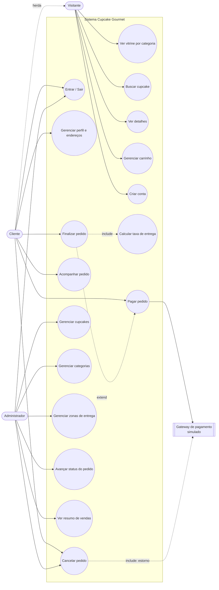
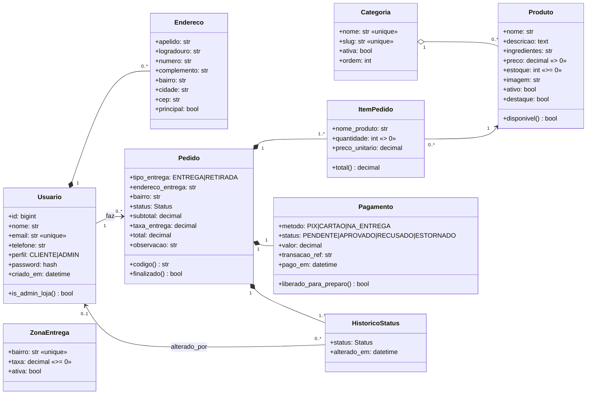
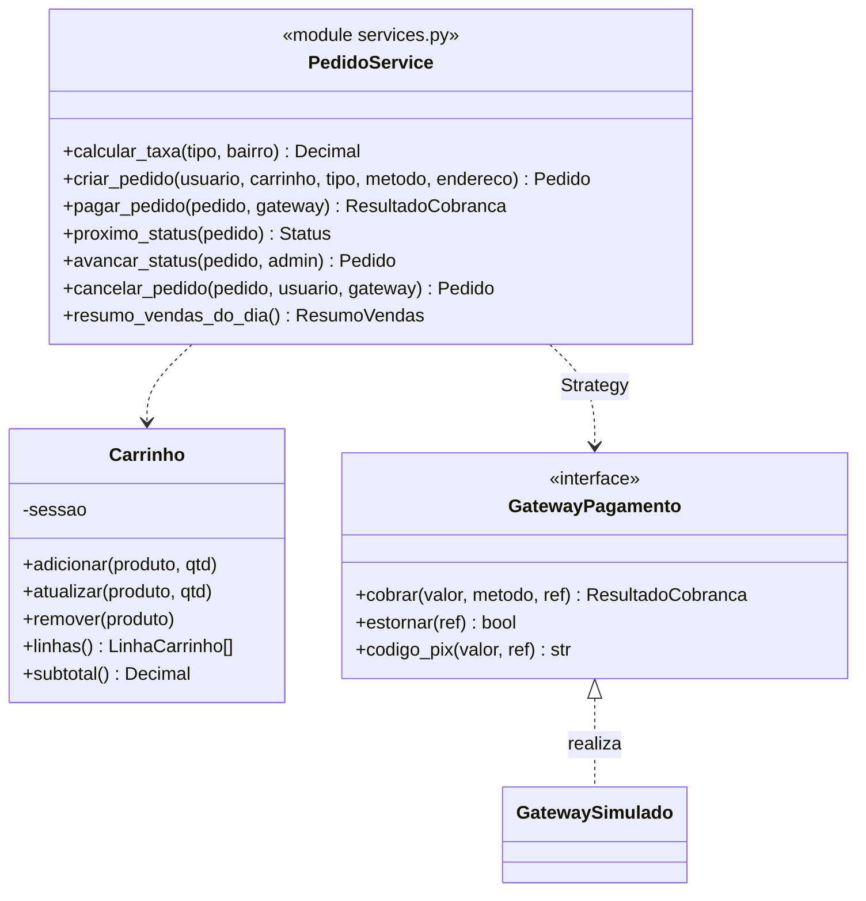
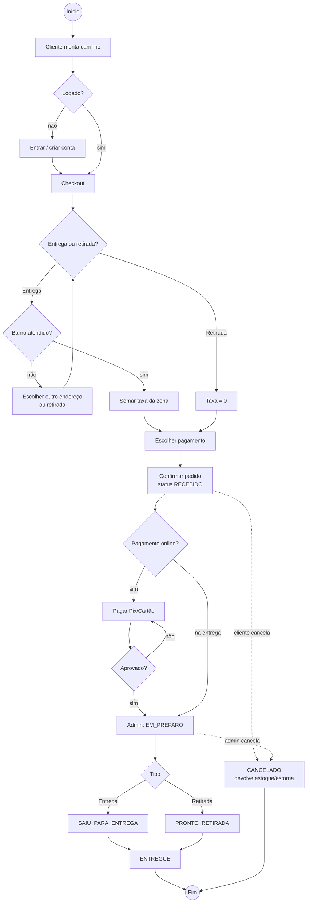
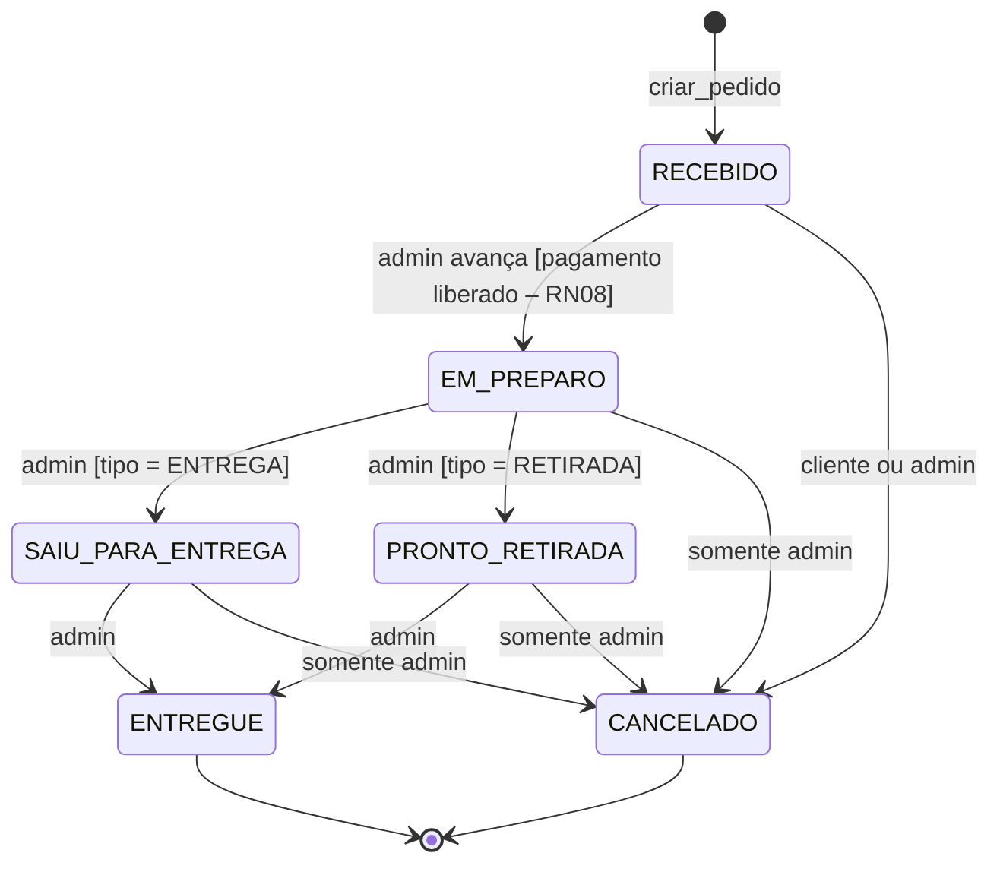

# Situação 1 · Modelagem UML

Os diagramas estão em Mermaid, que o GitHub renderiza automaticamente. Eles foram revisados para refletir **exatamente** o código entregue.

## 1. Diagrama de casos de uso



### Descrição do caso de uso principal: UC8 Finalizar pedido

| Campo | Descrição |
|---|---|
| Ator | Cliente (autenticado) |
| Pré-condições | Carrinho com pelo menos 1 item disponível |
| Fluxo principal | 1. O cliente abre o checkout. 2. O sistema mostra os itens, os endereços com a taxa de cada bairro e as formas de pagamento. 3. O cliente escolhe entrega/retirada, endereço e pagamento. 4. O sistema recalcula o total ao vivo. 5. O cliente confirma. 6. O sistema trava o estoque, valida a disponibilidade, cria o pedido com os preços congelados, baixa o estoque, registra o pagamento PENDENTE e o histórico RECEBIDO, e esvazia o carrinho. 7. Se o pagamento for online, redireciona para a tela de pagamento. Se não, para o detalhe do pedido. |
| Fluxos alternativos | **A1** Bairro não atendido: o endereço aparece desabilitado e o cliente pode escolher retirada. **A2** Sem endereço: o cliente cadastra um e volta ao checkout. **A3** Item esgotou entre o carrinho e a confirmação: a transação é desfeita e aparece "X acabou de esgotar. Ajuste seu carrinho." |
| Pós-condições | Pedido em `RECEBIDO`, estoque baixado e carrinho vazio |
| Regras | RN01, RN02, RN05, RN06 |

## 2. Diagrama de classes (domínio e persistência)



### Classes de serviço (camada de regras)



## 3. Diagrama de sequência: finalizar pedido e pagar com Pix

```mermaid
sequenceDiagram
    actor C as Cliente
    participant V as View (templates)
    participant CT as Controller<br/>pedidos.views
    participant S as services
    participant M as Models (ORM)
    participant DB as PostgreSQL
    participant GW as GatewaySimulado

    C->>CT: POST /checkout (tipo, endereço, PIX)
    CT->>S: criar_pedido(usuario, carrinho, ...)
    S->>S: calcular_taxa(bairro)
    S->>M: SELECT ... FOR UPDATE (produtos)
    M->>DB: BEGIN; lock nas linhas
    loop cada item
        S->>S: valida estoque e disponibilidade
        S->>M: cria ItemPedido(preço congelado)
        S->>M: UPDATE estoque = estoque - qtd
    end
    S->>M: cria Pagamento(PENDENTE) e Historico(RECEBIDO)
    M->>DB: COMMIT
    S-->>CT: pedido
    CT-->>C: 302 → /pedidos/{id}/pagamento
    C->>CT: GET pagamento
    CT->>GW: codigo_pix(valor, ref)
    CT->>V: render pagamento.html
    V-->>C: QR + "copia e cola"
    C->>CT: POST pagamento (confirmar)
    CT->>S: pagar_pedido(pedido)
    S->>GW: cobrar(valor, PIX, ref)
    GW-->>S: ResultadoCobranca(aprovado)
    S->>M: Pagamento → APROVADO
    CT-->>C: 302 → detalhe + "Pagamento aprovado!"
```

## 4. Diagrama de atividades: ciclo do pedido



## 5. Diagrama de estados do pedido


