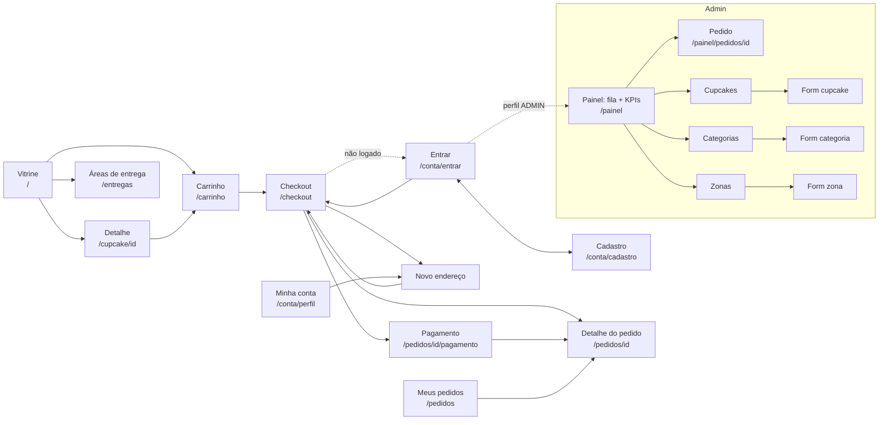

# Situação 1 · IHC (interface humano-computador)

## 1. Mapa de navegação

## 2. Protótipo

As telas implementadas são o protótipo de alta fidelidade. As capturas de tela ficam em [`docs/situacao-2/telas/`](../situacao-2/telas/).

| Tela | Elementos principais (catálogo de UI do material) |
|---|---|
| Vitrine | Busca (campo de pesquisa), *chips* de categoria (tags de navegação), cards com preço e botão "+ 🛒", seção de destaques |
| Detalhe | Imagem, selo de destaque, preço em evidência, seletor de quantidade (− / +), aviso de estoque, botão primário |
| Carrinho | Lista com seletor de quantidade e salvamento automático, remover, resumo fixo com subtotal |
| Checkout | 3 passos numerados (receber, endereço, pagamento) com *radio cards*, total recalculado ao vivo, botão desabilitado até a escolha ficar válida |
| Pagamento | Valor em destaque, QR ilustrativo, "copia e cola" com botão de copiar, confirmação |
| Pedido | Linha do tempo de status, resumo de itens, selo de pagamento, cancelamento com confirmação |
| Painel | Indicadores (pedidos, vendido, ticket médio, em aberto), alerta de estoque baixo, fila com botão de próxima etapa |

## 3. Princípios aplicados (material teórico e Norman)

| Princípio | Aplicação |
|---|---|
| **Clara e simples** | Uma ação primária por tela (botão rosa) e linguagem do cliente ("Finalizar pedido", não "Submeter") |
| **Consistente** | Mesmos componentes (botões, selos e cards) em todas as telas. Cores de status padronizadas: âmbar = aguardando, verde = concluído, cinza = cancelado. |
| **Controlada pelo usuário** | Nada acontece sem clique. O cliente pode "pagar depois", voltar ao carrinho e editar quantidades. |
| **Direta (causa e efeito)** | O badge do carrinho atualiza e o total do checkout muda ao trocar o endereço |
| **Recuperável** | Confirmação antes de cancelar ou excluir. "Excluir" com vínculo vira "desativar", sem perda de histórico. |
| **Dá resposta (feedback)** | Mensagem de sucesso, erro ou aviso após toda ação (`aria-live`) e linha do tempo do pedido |
| **Esteticamente agradável** | Paleta de confeitaria (creme, cacau, rosa), ilustrações próprias e tipografia Fredoka + Nunito |
| **Padrões inteligentes** | O endereço principal já vem marcado, a quantidade começa em 1 e o primeiro endereço vira principal automaticamente |
| **Mobile-first e acessibilidade** | Alvos de toque de pelo menos 44 px, barra inferior no celular, rótulos em todos os campos, foco visível e `alt` nas imagens |

## 4. Catálogo de mensagens

| Código | Situação | Mensagem exibida | Tipo |
|---|---|---|---|
| M01 | Conta criada | "Bem-vindo(a), {nome}! Sua conta foi criada." | sucesso |
| M02 | Login inválido | "E-mail ou senha incorretos." | erro |
| M03 | E-mail duplicado | "Já existe uma conta com este e-mail. Tente entrar." | erro de campo |
| M04 | Senhas diferentes | "As senhas não conferem." | erro de campo |
| M05 | LGPD não aceita | "É preciso aceitar para criar a conta." | erro de campo |
| M06 | Item adicionado | "{produto} adicionado ao carrinho." | sucesso |
| M07 | Acima do estoque | "Só temos {n} unidade(s) de {produto} hoje." | erro |
| M08 | Limite por item | "Máximo de 50 unidades por item." | erro |
| M09 | Produto indisponível | "{produto} não está disponível no momento." | erro |
| M10 | Bairro não atendido | "Ainda não entregamos no bairro {bairro}. Escolha retirada na loja." | erro |
| M11 | Esgotou no checkout | "{produto} acabou de esgotar. Ajuste seu carrinho." | erro |
| M12 | Pedido criado | "Pedido #{código} recebido!" | sucesso |
| M13 | Pagamento aprovado | "Pagamento aprovado! Já vamos preparar seus cupcakes." | sucesso |
| M14 | Pagamento recusado | "Pagamento recusado pela operadora (simulado). Tente novamente ou escolha outra forma." | erro |
| M15 | Cancelamento negado | "O pedido já está em preparo e não pode mais ser cancelado. Fale com a loja." | erro |
| M16 | Preparo sem pagamento | "Aguardando confirmação do pagamento para iniciar o preparo." | erro (admin) |
| M17 | Exclusão com vínculo | "“{item}” tem pedidos ou produtos vinculados; foi desativado(a) em vez de excluído(a)." | aviso (admin) |
| M18 | 404 | "Esse cupcake saiu do forno e sumiu. Confira o endereço ou volte à vitrine." | página |
| M19 | 403 | "Esta área é exclusiva da equipe da loja." | página |
| M20 | 500 | "Tivemos um problema do nosso lado. Tente novamente em instantes." | página |
