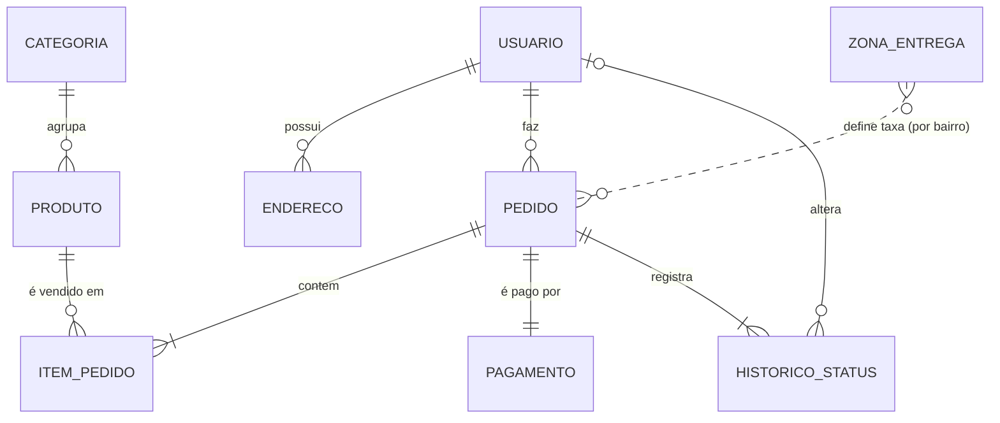

# Situação 1 · Projeto de banco de dados

SGBD: **PostgreSQL 17** (Neon, em produção). O esquema é criado pelas *migrations* do Django e o DDL equivalente está em [ddl-postgres.sql](ddl-postgres.sql).

## 1. Modelo conceitual (DER)



## 2. Modelo lógico (3ª forma normal)

```
usuario(id PK, email UK, password, nome, telefone, perfil, is_active, is_staff, is_superuser, last_login, date_joined, criado_em)
endereco(id PK, usuario_id FK→usuario, apelido, logradouro, numero, complemento, bairro, cidade, cep, principal)
categoria(id PK, nome UK, slug UK, ativa, ordem)
produto(id PK, categoria_id FK→categoria, nome, descricao, ingredientes, preco, estoque, imagem, ativo, destaque, criado_em, atualizado_em)
        UK(categoria_id, nome)
zona_entrega(id PK, bairro UK, taxa, ativa)
pedido(id PK, usuario_id FK→usuario, tipo_entrega, endereco_entrega, bairro, status, subtotal, taxa_entrega, total, observacao, criado_em, atualizado_em)
item_pedido(id PK, pedido_id FK→pedido, produto_id FK→produto, nome_produto, quantidade, preco_unitario)
        UK(pedido_id, produto_id)
pagamento(id PK, pedido_id FK→pedido UK, metodo, status, valor, transacao_ref, pago_em)
historico_status(id PK, pedido_id FK→pedido, status, alterado_por_id FK→usuario NULL, alterado_em)
```

### Decisões de normalização e desnormalização controlada

- **1FN:** todos os atributos são atômicos. O endereço é decomposto em logradouro, número, bairro etc.
- **2FN:** as tabelas usam chave substituta simples (`id`), então não existe dependência parcial.
- **3FN:** a taxa de entrega depende do bairro e por isso fica em `zona_entrega`, não em `endereco`. A categoria fica em tabela própria.
- **Cópias históricas intencionais (*snapshot*):** `item_pedido.preco_unitario` e `nome_produto`, e `pedido.endereco_entrega`, `bairro` e `taxa_entrega`. Elas **não** são redundância: registram o fato no momento da compra (RN02). Se o cliente mudar de endereço ou a loja mudar o preço, o pedido antigo não pode mudar.
- `pedido.subtotal` e `total` são derivados, mas ficam armazenados porque são o valor efetivamente cobrado e auditável.
- `pedido` não tem FK para `zona_entrega` de propósito: zonas podem ser desativadas ou excluídas sem afetar o histórico.

## 3. Dicionário de dados

### usuario
| Coluna | Tipo | Nulo | Restrição / domínio | Descrição |
|---|---|---|---|---|
| id | bigint | não | PK, identity | Identificador |
| email | varchar(254) | não | UNIQUE, formato de e-mail, gravado em minúsculas | Login |
| password | varchar(128) | não | hash PBKDF2-SHA256 | Senha (nunca em texto puro) |
| nome | varchar(120) | não | | Nome completo |
| telefone | varchar(20) | não ('' permitido) | regex `[0-9()+\-\s]{8,20}` | Contato |
| perfil | varchar(10) | não | CHECK ∈ {CLIENTE, ADMIN}, default CLIENTE | Papel na loja (RN07) |
| is_active | boolean | não | default true | Conta ativa |
| is_staff / is_superuser | boolean | não | | Acesso ao /django-admin |
| last_login | timestamptz | sim | | Último acesso |
| date_joined / criado_em | timestamptz | não | default now | Cadastro |

### endereco
| Coluna | Tipo | Nulo | Restrição / domínio | Descrição |
|---|---|---|---|---|
| id | bigint | não | PK | |
| usuario_id | bigint | não | FK → usuario ON DELETE CASCADE | Dono |
| apelido | varchar(40) | não | default 'Casa' | Ex.: Casa, Trabalho |
| logradouro | varchar(150) | não | | Rua/avenida |
| numero | varchar(10) | não | | Número |
| complemento | varchar(60) | não ('' permitido) | | Apto, bloco |
| bairro | varchar(80) | não | comparado sem diferenciar maiúsculas com `zona_entrega.bairro` | Define a taxa |
| cidade | varchar(80) | não | default 'São Paulo' | |
| cep | varchar(9) | não | regex `\d{5}-?\d{3}` | CEP |
| principal | boolean | não | 1 principal por usuário (regra na aplicação) | Endereço padrão no checkout |

### categoria
| Coluna | Tipo | Nulo | Restrição | Descrição |
|---|---|---|---|---|
| id | bigint | não | PK | |
| nome | varchar(60) | não | UNIQUE | Ex.: Clássicos, Gourmet |
| slug | varchar(70) | não | UNIQUE | Usado na URL do filtro |
| ativa | boolean | não | default true | Se for false, os produtos somem da vitrine |
| ordem | smallint | não | ≥ 0, default 0 | Ordem dos *chips* |

### produto
| Coluna | Tipo | Nulo | Restrição / domínio | Descrição |
|---|---|---|---|---|
| id | bigint | não | PK | |
| categoria_id | bigint | não | FK → categoria ON DELETE PROTECT | |
| nome | varchar(80) | não | UNIQUE(categoria_id, nome) | |
| descricao | text | não | até 600 caracteres | |
| ingredientes | varchar(300) | não ('' permitido) | | Informação sobre alergênicos |
| preco | numeric(8,2) | não | CHECK preco > 0 | Preço atual |
| estoque | integer | não | CHECK estoque ≥ 0 | Unidades disponíveis hoje |
| imagem | varchar(120) | não | ∈ ilustrações cadastradas | Caminho estático |
| ativo | boolean | não | default true | Se for false, não aparece (RN01) |
| destaque | boolean | não | default false | Aparece em "Destaques do dia" |
| criado_em / atualizado_em | timestamptz | não | | Auditoria |

### zona_entrega
| Coluna | Tipo | Nulo | Restrição | Descrição |
|---|---|---|---|---|
| id | bigint | não | PK | |
| bairro | varchar(80) | não | UNIQUE | Bairro atendido |
| taxa | numeric(6,2) | não | CHECK taxa ≥ 0 | Valor da entrega (RN05) |
| ativa | boolean | não | default true | |

### pedido
| Coluna | Tipo | Nulo | Restrição / domínio | Descrição |
|---|---|---|---|---|
| id | bigint | não | PK | Exibido como `#00042` |
| usuario_id | bigint | não | FK → usuario ON DELETE PROTECT | Cliente |
| tipo_entrega | varchar(10) | não | ∈ {ENTREGA, RETIRADA} | |
| endereco_entrega | varchar(300) | não ('' na retirada) | snapshot | Endereço no momento da compra |
| bairro | varchar(80) | não ('' na retirada) | snapshot | |
| status | varchar(20) | não | ∈ {RECEBIDO, EM_PREPARO, SAIU_PARA_ENTREGA, PRONTO_RETIRADA, ENTREGUE, CANCELADO} | RN03 |
| subtotal | numeric(10,2) | não | Σ itens | |
| taxa_entrega | numeric(6,2) | não | CHECK: RETIRADA ⇒ 0 | |
| total | numeric(10,2) | não | CHECK total ≥ 0; = subtotal + taxa | Valor cobrado |
| observacao | varchar(300) | não ('' permitido) | | |
| criado_em / atualizado_em | timestamptz | não | | |

### item_pedido
| Coluna | Tipo | Nulo | Restrição | Descrição |
|---|---|---|---|---|
| id | bigint | não | PK | |
| pedido_id | bigint | não | FK → pedido ON DELETE CASCADE | |
| produto_id | bigint | não | FK → produto ON DELETE PROTECT; UNIQUE(pedido_id, produto_id) | |
| nome_produto | varchar(80) | não | snapshot | |
| quantidade | integer | não | CHECK > 0 | |
| preco_unitario | numeric(8,2) | não | snapshot (RN02) | |

### pagamento
| Coluna | Tipo | Nulo | Restrição / domínio | Descrição |
|---|---|---|---|---|
| id | bigint | não | PK | |
| pedido_id | bigint | não | FK → pedido, UNIQUE (1:1) | |
| metodo | varchar(12) | não | ∈ {PIX, CARTAO, NA_ENTREGA} | |
| status | varchar(10) | não | ∈ {PENDENTE, APROVADO, RECUSADO, ESTORNADO} | RN08 |
| valor | numeric(10,2) | não | = pedido.total | |
| transacao_ref | varchar(64) | não ('' permitido) | | ID devolvido pelo gateway |
| pago_em | timestamptz | sim | | Data da aprovação |

### historico_status
| Coluna | Tipo | Nulo | Restrição | Descrição |
|---|---|---|---|---|
| id | bigint | não | PK | |
| pedido_id | bigint | não | FK → pedido ON DELETE CASCADE | |
| status | varchar(20) | não | mesmo domínio de pedido.status | |
| alterado_por_id | bigint | sim | FK → usuario ON DELETE SET NULL | Quem mudou |
| alterado_em | timestamptz | não | default now | Alimenta a linha do tempo (US17) |

## 4. Índices

Além das PKs e UNIQUEs, o Django cria índices em todas as FKs (`usuario_id`, `categoria_id`, `pedido_id`, `produto_id`). As consultas mais frequentes são a vitrine (`ativo`, `estoque`, `categoria_id`) e a fila do painel (`status`). Com o volume esperado (dezenas de produtos e centenas de pedidos por dia), não há necessidade de índices adicionais na v1.
