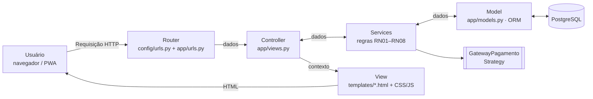

# Situação 2 · Arquitetura e codificação

## 1. Visão geral

**Monólito MVC renderizado no servidor**, com a camada de regras de negócio (*services*) separada dos controllers.



O fluxo segue exatamente a Figura 2 do material da disciplina (Usuário → Router → Controller ↔ Model → View → HTML). A diferença é uma camada de *services* entre o Controller e o Model. Ela concentra as regras de negócio e permite testá-las sem HTTP.

### Mapeamento MVC ↔ Django (MTV)

O Django chama o padrão de MTV (Model-Template-View), que é o MVC com outros nomes:

| MVC (material) | Django | Neste projeto |
|---|---|---|
| **Model** | `models.py` (ORM) | `contas/models.py`, `catalogo/models.py`, `pedidos/models.py` |
| **View** | *Templates* | `templates/**/*.html`, `static/css/app.css`, `static/js/app.js` |
| **Controller** | *Views* (`views.py`) + URLconf | `*/views.py`, `*/urls.py` |
| Regras de negócio | (não prescrito) | `pedidos/services.py`, `pedidos/carrinho.py`, `pedidos/pagamento.py` |

## 2. Módulos (apps)

| App | Responsabilidade | Histórias |
|---|---|---|
| `contas` | Usuário (login por e-mail, perfil CLIENTE/ADMIN) e endereços | US01–US03 |
| `catalogo` | Categorias, produtos, vitrine, busca e detalhe. Comando `seed`. | US04–US06 |
| `pedidos` | Carrinho, checkout, pagamento, acompanhamento e zonas de entrega | US09–US11, US13, US14, US16, US17 |
| `painel` | Área do administrador: fila de pedidos, indicadores e cadastros | US07, US08, US12, US15 |
| `config` | Settings (12-factor), rotas raiz e páginas de erro | — |

## 3. Padrões de projeto aplicados

| Padrão | Onde | Por quê |
|---|---|---|
| **MVC** | Toda a aplicação | Exigido pela disciplina. Separa apresentação, controle e dados. |
| **Service Layer** | `pedidos/services.py` | Regras de negócio sem dependência de HTTP. Testáveis e reutilizáveis (ex.: uma futura API para app nativo). |
| **Strategy** | `GatewayPagamento` → `GatewaySimulado` | Troca do provedor de pagamento sem alterar as regras |
| **Repository/QuerySet** | `ProdutoQuerySet.disponiveis()` | Uma única definição de "produto disponível" (RN01) |
| **Unit of Work** | `@transaction.atomic` + `select_for_update` | Pedido, itens, estoque e pagamento são gravados de forma atômica, e o lock evita vender acima do estoque em compras simultâneas |
| **Decorator** | `admin_requerido`, `login_required`, `require_POST` | Autorização e método HTTP declarativos |
| **Template Method / herança de templates** | `base.html` + `` | Layout consistente (princípio de IHC) |
| **Snapshot** | Preço e endereço copiados no pedido | Integridade histórica (RN02) |

## 4. Tratamento de erros

| Camada | Estratégia |
|---|---|
| Regra de negócio | `ErroPedido` / `ErroCarrinho` com mensagem pronta para o usuário. O controller captura e exibe com `messages.error`. |
| Formulários | Validação de campo e de formulário (e-mail único, senha forte, CEP, telefone, preço > 0) com mensagens em português |
| Banco | CHECK, UNIQUE e FK como última barreira (RNF08) |
| HTTP | Páginas 403/404/500 personalizadas. Rotas de escrita aceitam só POST e têm CSRF. |
| Concorrência | `select_for_update` no checkout. Se um item esgotar, a transação inteira é desfeita. |
| Segurança | Proteção contra open redirect (`destino_seguro`). O cliente só acessa os próprios recursos (404 para os demais). |

## 5. Estrutura de pastas

```
cupcake-gourmet/
├── config/              settings, urls raiz, páginas de erro, wsgi
├── contas/              Usuario, Endereco · cadastro, login, perfil
├── catalogo/            Categoria, Produto · vitrine, detalhe · management/commands/seed.py
├── pedidos/             ZonaEntrega, Pedido, ItemPedido, Pagamento, HistoricoStatus
│   ├── carrinho.py      carrinho em sessão
│   ├── services.py      regras de negócio
│   ├── pagamento.py     Strategy de gateway
│   └── templatetags/    filtros |brl e |cor_status
├── painel/              área administrativa
├── templates/           camada View (HTML)
├── static/              CSS, JS, ilustrações SVG, ícone PWA
├── tests/               unitários, integração e aceitação (pytest)
├── docs/                situacao-1, situacao-2, situacao-3
├── render.yaml, build.sh  deploy (IaC)
└── .github/workflows/   CI: testes em Postgres a cada push
```

## 6. Ambiente e execução

| Ambiente | Banco | Como roda |
|---|---|---|
| Desenvolvimento | SQLite (`db.sqlite3`) | `python manage.py runserver` |
| CI (GitHub Actions) | PostgreSQL 17 (container) | `coverage run -m pytest` |
| Produção | PostgreSQL (Neon) | Render: `gunicorn config.wsgi` com WhiteNoise para os estáticos |

A configuração vem toda de variáveis de ambiente (`DEBUG`, `SECRET_KEY`, `DATABASE_URL`, `ADMIN_EMAIL`, `ADMIN_PASSWORD`). Nenhum segredo é versionado.

## 7. Tabela da atividade (PIT_atividade.docx)

| Campo | Valor |
|---|---|
| Linguagem do back-end | Python 3.14 (Django 6.0, padrão MVC/MTV) |
| Banco de dados | PostgreSQL 17 (Neon), SQLite em desenvolvimento |
| Hospedagem | Render (web service) + Neon (banco) |
| Plataforma | Web responsiva mobile-first (PWA instalável em Android/iOS/desktop) |
| Modo de codificação | (X) Tradicional |
