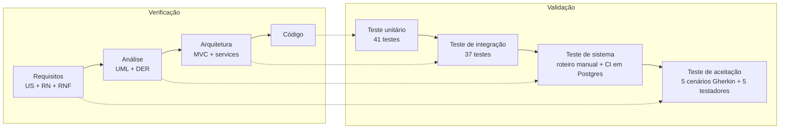

# Situação 3 · Plano e relatório de testes (verificação e validação)

## 1. Estratégia (Modelo V)



| Nível | O que valida | Ferramenta | Onde |
|---|---|---|---|
| **Verificação** | O código está de acordo com a especificação | Revisão de código, `manage.py check --deploy`, `makemigrations --check`, revisão da rastreabilidade (requisitos §6) | CI + revisão manual |
| Unitário | Regras de negócio isoladas (RN01–RN08), carrinho e gateway | pytest | `tests/test_unit_*.py` |
| Integração | Controller + template + ORM + banco via cliente HTTP, autorização e CSRF | pytest-django | `tests/test_integracao_views.py` |
| Sistema | Aplicação completa em ambiente igual ao de produção (Postgres) | GitHub Actions + roteiro manual (§4) | `.github/workflows/testes.yml` |
| **Aceitação / validação** | O produto atende às histórias do cliente | Cenários Gherkin automatizados + 5 testadores externos (laudos) | `tests/test_aceitacao.py`, `laudos/` |

**Critério de saída:** 100% dos testes automatizados passando, cobertura ≥ 70% (RNF06), nenhum defeito crítico aberto e os 5 laudos coletados com as correções pertinentes aplicadas.

## 2. Como executar

```bash
pip install -r requirements-dev.txt
coverage run -m pytest          # todos
pytest -m unitario              # por nível: unitario | integracao | aceitacao
coverage report                 # cobertura
```

## 3. Resultado da execução automatizada

Executado em 14/11/2026 (Windows 11, Python 3.14.2, Django 6.0.10, SQLite). O CI repete a execução em PostgreSQL 17 a cada push.

| Nível | Testes | Passaram | Falharam |
|---|---|---|---|
| Unitário | 41 | 41 | 0 |
| Integração | 37 | 37 | 0 |
| Aceitação | 5 | 5 | 0 |
| **Total** | **83** | **83** | **0** |

**Cobertura de código: 94%** (meta do RNF06: 70%)

| Módulo | Cobertura |
|---|---|
| `pedidos/services.py` (regras de negócio) | 98% |
| `pedidos/carrinho.py` | 97% |
| `contas/models.py` | 97% |
| `painel/views.py` | 96% |
| `pedidos/models.py` | 95% |
| `pedidos/views.py` | 88% |
| `contas/views.py` | 80% |
| demais módulos | 100% |

### Defeitos encontrados pelos testes durante o desenvolvimento

| # | Defeito | Como foi encontrado | Correção |
|---|---|---|---|
| D1 | O teste esperava a mensagem de estoque para 99 unidades, mas o limite de 50 por item é verificado antes | Teste de integração falhou | Teste ajustado para cobrir as duas mensagens (11 → estoque, 99 → limite) |
| D2 | O parâmetro `next` aceitava URLs externas (*open redirect*) | Revisão de código (verificação) | Função `destino_seguro` com `url_has_allowed_host_and_scheme` + teste `test_open_redirect_bloqueado` |
| D3 | Recusa de pagamento simulada (total terminando em ,13) era impossível de reproduzir com os preços reais | Revisão do manual (validação) | Botão "Simular pagamento recusado (teste)" + teste de nova tentativa |
| D4 | Layout mobile parecia cortado nas capturas | Teste visual em 390 px | Falso positivo do navegador headless (largura mínima). Confirmado com iframe de 390 px. Sem alteração. |

## 4. Roteiro de teste de sistema (manual)

| # | Passo | Resultado esperado | OK? |
|---|---|---|---|
| S1 | Abrir a URL pública no celular | Vitrine em 2 colunas e barra inferior visível | |
| S2 | Buscar "pistache" | Só o Pistache Siciliano aparece | |
| S3 | Adicionar 2 unidades e abrir o carrinho | Badge 2 e subtotal correto | |
| S4 | Finalizar sem estar logado | Redireciona para entrar e depois volta ao checkout | |
| S5 | Criar conta com senha "123" | Mensagem de senha fraca | |
| S6 | Checkout com endereço em bairro não atendido | Opção desabilitada com aviso | |
| S7 | Confirmar com Pix e clicar em "Simular pagamento recusado" | Mensagem de recusa e possibilidade de tentar de novo | |
| S8 | Confirmar o pagamento | "Pagamento aprovado!" e pagamento Aprovado | |
| S9 | Admin: avançar o pedido até Entregue | Linha do tempo completa no cliente | |
| S10 | Cliente: cancelar um pedido Recebido | Status Cancelado e estoque restaurado | |
| S11 | Admin: excluir um cupcake com pedidos | Vira "inativo" e some da vitrine | |
| S12 | Cliente acessa `/painel/` | Página 403 amigável | |
| S13 | Instalar o PWA (Adicionar à tela inicial) | Ícone de cupcake e abertura em tela cheia | |

## 5. Validação com usuários

Veja o [template do laudo](02-template-laudo-testador.md), os [laudos preenchidos](laudos/) e o [laudo de qualidade](03-laudo-de-qualidade.md).
